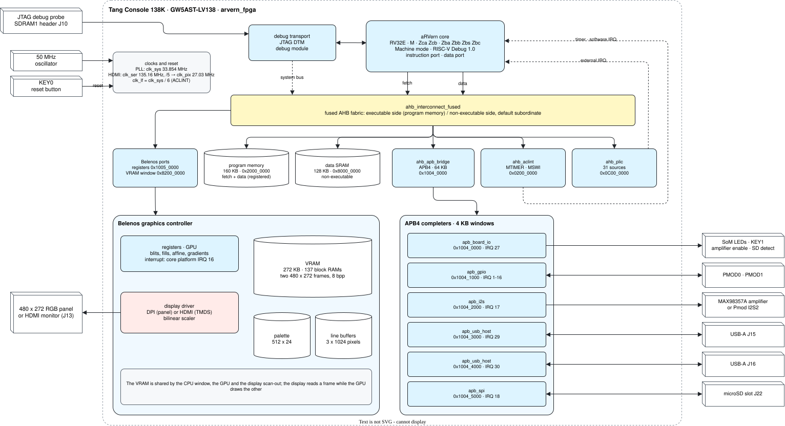

<p align="center">
  <picture>
    <source media="(prefers-color-scheme: dark)"
            srcset="https://raw.githubusercontent.com/Arvern-Silicon/arvern/main/doc/img/aRVern_dark_title.png">
    
  </picture>
</p>

# aRVern on the Sipeed Tang Console 138K

*A small game console built around the aRVern RISC-V core: the Belenos graphics
controller on an LCD panel or an HDMI monitor, stereo audio, two USB ports for a
keyboard, a mouse or a gamepad, a microSD card, and a boot menu that starts the
programs on the card.*

The board is the Sipeed Tang Console 138K (a Tang Mega 138K SoM, Gowin
GW5AST-LV138PG484A). Everything the SoC needs is inside the FPGA: the program
memory, the data SRAM and the video RAM are block RAMs, and every peripheral is an IP
of [`arvern-ips`](https://github.com/Arvern-Silicon/arvern-ips) or of
[`arvern-belenos`](https://github.com/Arvern-Silicon/arvern-belenos). The top level is
[`rtl/verilog/arvern_fpga.v`](rtl/verilog/arvern_fpga.v); the bus system, with the
address map and the interrupt wiring, is
[`rtl/verilog/ahb_bus_system.v`](rtl/verilog/ahb_bus_system.v).



---

## The core

| Feature | This build |
|---|---|
| Base ISA | RV32E (16 registers) |
| Extensions | M (one-cycle multiplier, 33-cycle divider), Zca + Zcb, Zba + Zbb + Zbs + Zbc |
| Privilege | Machine mode only (no S/U, no PMP) |
| Counters | none (`time` comes from the ACLINT) |
| Debug | RISC-V Debug 1.0, JTAG transport (`DTM_TYPE = 0`) on the SDRAM1 header J10 |
| Branches | one bubble on a taken branch (`SINGLE_CYCLE_BRANCH = 0`) |
| Reset | synchronous (`ASYNC_RST_EN = 0`) |

The parameters are at the top of [`arvern_fpga.v`](rtl/verilog/arvern_fpga.v). The
firmware is built for the same ISA: every app's Makefile reads the `-march` the RTL
generates, so a core rebuilt with other extensions gets matching code.

## Clocks and reset

| Clock | Frequency | Source | Clocks |
|---|---|---|---|
| `clk_sys` | 33.854 MHz | PLL from the 50 MHz oscillator | the whole SoC: core, buses, memories, peripherals |
| `clk_lf` | 5.642 MHz | `clk_sys` / 6 | the ACLINT's `mtime` timebase (one tick = 177 ns) |
| `clk_ser` | 135 MHz | PLL (HDMI build only) | the TMDS serialisers |
| `clk_pix` | 27 MHz | `clk_ser` / 5 (HDMI build only) | Belenos's HDMI pixel side |
| `clk_pix` | 11.285 MHz | second output of the system PLL (LCD build only) | Belenos's panel timing (`DPI_PCLK_SEP = 1`) |

On the LCD build the panel timing runs on its own pixel clock (`BOARD_LCD_PCLK_SEP = 1`, the
default; with 0 it is derived from `clk_sys` inside Belenos). The
reset combines `KEY0` and the PLL lock. The board's mode button reloads the FPGA from
its configuration flash, which is how the boot menu comes back from any program.

## Memory and address map

| Base | Size | Region | Notes |
|---|---|---|---|
| `0x0200_0000` | 64 KB | ACLINT | `mtime`, `mtimecmp`, software interrupt |
| `0x0C00_0000` | 4 MB | PLIC | 31 sources, one hart, Machine context |
| `0x1004_0000` | 64 KB | APB4 peripherals | six completers, 4 KB each (below) |
| `0x1005_0000` | 4 KB | Belenos registers | display, GPU, palette |
| `0x2000_0000` | 160 KB | Program memory | the only executable region; the program image |
| `0x8000_0000` | 128 KB | Data SRAM | data, stack, heap; not executable |
| `0x8200_0000` | 272 KB | Belenos VRAM window | two 480 × 272 frames at 8 bpp, plus 17 KB |

The program memory is the fused SRAM controller of
[`ahb_interconnect_fused`](https://github.com/Arvern-Silicon/arvern-ips/blob/main/ahb_interconnect/doc/ahb_interconnect.md):
the core fetches from one port and reads or writes data on the other, so a program can
read its constant tables, and the boot menu can write the next program into it. Its
data port is registered (`PMEM_B_APH_REG`): a data access to the program memory takes
one wait state, two when it meets an instruction fetch, which keeps the 20 memory banks' select off the core's data-address
path; instruction fetch is unaffected.

| APB base | Completer | Board connection |
|---|---|---|
| `0x1004_0000` | [`apb_board_io`](rtl/verilog/apb_board_io.v) | the SoM LEDs, `KEY1`, the sound output (`AUDIO_OUT`: HDMI, speaker or Pmod I2S2; the amplifier on for the speaker only), the microSD card detect, a TTY register for the simulation |
| `0x1004_1000` | [`apb_gpio`](https://github.com/Arvern-Silicon/arvern-ips/blob/main/apb_gpio/doc/apb_gpio.md), 16 pins | PMOD0 (pins 0–7) and PMOD1 (pins 8–15) |
| `0x1004_2000` | [`apb_i2s`](https://github.com/Arvern-Silicon/arvern-ips/blob/main/apb_i2s/doc/apb_i2s.md) | one stream to the selected output: HDMI audio (Belenos), the onboard MAX98357A amplifier or a Pmod I2S2 on PMOD1 (HDMI from reset in the HDMI build, the Pmod in the panel build) |
| `0x1004_3000` | [`apb_usb_host`](https://github.com/Arvern-Silicon/arvern-ips/blob/main/apb_usb_host/doc/apb_usb_host.md) | USB-A J15 |
| `0x1004_4000` | [`apb_usb_host`](https://github.com/Arvern-Silicon/arvern-ips/blob/main/apb_usb_host/doc/apb_usb_host.md) | USB-A J16 |
| `0x1004_5000` | [`apb_spi`](https://github.com/Arvern-Silicon/arvern-ips/blob/main/apb_spi/doc/apb_spi.md) | the microSD slot J22, in SPI mode |

[`software/bsp/tang_board.h`](software/bsp/tang_board.h) holds every base address,
size and interrupt number for the firmware.

## Interrupts

| PLIC source | From |
|---|---|
| 1–16 | PMOD GPIO pins 0–15 |
| 17 | I2S master |
| 18 | SPI controller (microSD) |
| 27 | `KEY1` edge |
| 28 | switch edge (`apb_board_io` has switch inputs; this board has none, so it never fires) |
| 29 | USB host J15 |
| 30 | USB host J16 |

The PLIC drives the core's machine external interrupt. Belenos has its own line: the
core's platform interrupt 16 (`mip[16]`, `mcause` 16). The ACLINT's timer and software
interrupts go to the core directly.

## Graphics and display

Belenos draws into the VRAM with its GPU (blits, fills, affine blits, gradients, lines; the
`classic` persona, with the hardware cursor) or
the CPU writes the VRAM window directly. Its display driver scans a frame out of the
VRAM through a 512-entry palette and three 1024-pixel line buffers (bilinear scaling).
One bitstream drives one of two displays, chosen at build time:

| Build | Display | Picture |
|---|---|---|
| LCD | Sipeed 4.3-inch 480 × 272 RGB panel, 40-pin connector | native, 60 Hz |
| HDMI | a TV or monitor on J13, 720 × 480 at 60 Hz (CTA-861 VIC 3, 16:9) | 480 × 272 scaled up |

The same firmware runs on both: it asks Belenos which driver it has.

## Block-RAM budget

| Memory | Block RAMs |
|---|---:|
| Belenos VRAM, 272 KB | 137 |
| Program memory, 160 KB | 80 |
| Data SRAM, 128 KB | 64 |
| Display line buffers | 6 |
| Palette | 1 |
| **Total** | **288 of 340** |

No other IP uses block RAM: the peripherals' FIFOs and buffers are registers.

---

## Building

```bash
cd synthesis/gowin
./0_create_bitstream.sh boot_menu            # HDMI build of the boot menu (the default)
./0_create_bitstream.sh demo_mode7 lcd       # any app, LCD build
./1_program_fpga.sh boot_menu_hdmi           # load into the FPGA (lost at power-off)
./2_program_flash.sh boot_menu_hdmi          # write the flash: the menu at every power-up
```

`0_create_bitstream.sh` builds the app's firmware first and makes it the program
memory's initial content; the bitstream lands in `synthesis/gowin/bitstreams/`. Gowin
EDA is found on the `PATH` or through `GOWIN_HOME`. Its defaults meet timing on both
displays: five placement algorithms run in parallel and the best is kept (25 to 45
minutes); Gowin's results vary from run to run, so a build that fails timing is worth
running again before changing anything. Both programming scripts use the
board's USB port marked MCU (the onboard BL616 USB-JTAG), through the Gowin
Programmer's command line (`programmer_cli`); `USE_OFL=1` selects `openFPGALoader`
instead.

Prebuilt boot-menu bitstreams and an example microSD card are attached to every release
on the [arvern-soc releases page](https://github.com/Arvern-Silicon/arvern-soc/releases);
the repository holds no bitstreams. `tang-console-138k_boot_menu_lcd.zip` and
`tang-console-138k_boot_menu_hdmi.zip` each hold the `.fs` bitstream of the boot menu for
that display: unzip one into `synthesis/gowin/bitstreams/` and program it with
`1_program_fpga.sh` or `2_program_flash.sh` as above. `tang-console-138k_sdcard.zip` is the
content of a FAT32 microSD card: its `APPS` and `MEDIA` folders go at the card's root.

## Software

| Directory | Content |
|---|---|
| [`software/bsp`](software/bsp) | `tang_board.h` (the map above), the LED / key / switch driver, the USB HID layer over the `apb_usb_host` driver |
| [`software/lib`](software/lib) | `demo_kit` (display and input helpers), FatFs, the SEGGER RTT library |
| [`software/apps`](software/apps) | the boot menu; ports of Commander Keen 4, Prince of Persia, Wolfenstein 3D and Zork; an LVGL demo on the Belenos draw unit; the audio player, the picture viewer; the demos of the DE0 build at 480 × 272; tests |

The IP drivers come from `arvern-ips/<ip>/sw` and `arvern-belenos`, compiled into each
app. The [boot menu](software/apps/boot_menu/README.md) is what the board runs at
power-up: it lists the programs in `/APPS` on the microSD card, plays music, and loads
the chosen program into the program memory over itself; its
[`tools/sd_install.py`](software/apps/boot_menu/tools/sd_install.py) puts a program on
a card.

## Simulation

```bash
cd sim/rtl_sim/run
./run tst_usb_hid -nodump          # any app with a stimulus in sim/rtl_sim/src
./run demo_mode7 -screen           # a window showing the panel, LEDs, keys and switches
```

The bench ([`bench/verilog/tb_arvern_fpga.v`](bench/verilog/tb_arvern_fpga.v)) models
the board around the FPGA: a panel that saves its frames, a microSD card, the HDMI
monitor's DDC, and a low-speed USB device on each USB port. Each app's stimulus in
`sim/rtl_sim/src` drives it and checks the result.
[`sim/rtl_sim/bin/soc_regress.py`](sim/rtl_sim/bin/soc_regress.py) runs the board
regression (a quick and a nightly tier, the HDMI build as a variant) and compares the
saved frames with golden image lists.

## Debug

[`debug/README.md`](debug/README.md) covers the debug adapters, the OpenOCD and GDB set-up
and the IDE integration for the core's JTAG link on J10.
